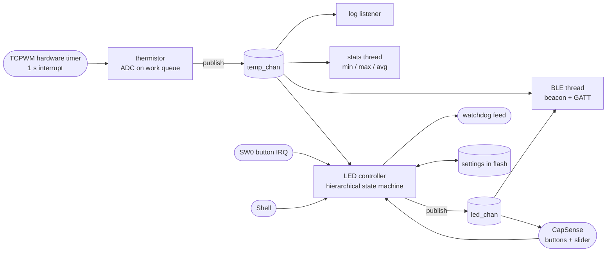

# PSoC 6 Exploration

A collection of embedded projects on the **Infineon CY8CPROTO-062-4343W** prototyping kit,
built with **Zephyr RTOS** (Infineon's Zephyr SDK). Each project lives in its own folder under
[`apps/`](apps) and explores a different side of the board and of Zephyr.

**The board:** PSoC 62 MCU (Cortex-M4 @ 100 MHz + Cortex-M0+, 2 MB flash, 1 MB SRAM),
Murata 1DX module with a CYW4343W Wi-Fi + Bluetooth radio, CAPSENSE buttons and slider,
a thermistor, PDM microphones, QSPI flash, and an onboard KitProg3 debugger.

## Projects

| Project | What it does | Highlights |
|---|---|---|
| [**Thermo-Blinky**](#thermo-blinky--a-multithreaded-sensor-node) <br> `apps/rtos_blinky` | A small multithreaded sensor node: reads the onboard thermistor, shows the temperature on the LED, broadcasts it over Bluetooth LE, and takes input from touch buttons, a slider, and a serial shell | Threads, zbus, a hierarchical state machine, BLE GATT, CapSense, flash settings, watchdog |

---

## Thermo-Blinky — a multithreaded sensor node

What started as a blinking LED grew one Zephyr subsystem at a time into a small
"smart sensor". The board measures temperature once a second, the LED reacts to it,
a phone can watch both over Bluetooth, and you control it by touch or from a terminal.

### What it does

**Senses**
- 🌡️ **Temperature** from the onboard NTC thermistor, read by the ADC once per second. A
  hardware timer sets the pace, and the reading is published to the rest of the app.
- 👆 **Touch** on two CAPSENSE buttons and a 5-segment slider, using Infineon's CapSense
  middleware ported to Zephyr.
- 🔘 **A mechanical button** (SW0) that steps through preset blink rates.

**Reacts**
- 💡 **The LED shows the temperature** in *temperature mode*:

  | Temperature | LED |
  |---|---|
  | Below the *cold* limit | Solid on |
  | Between the limits | Slow blink (1 s) |
  | At or above the *hot* limit | Fast blink (100 ms) |

  Limits have 0.5 °C hysteresis, so the LED doesn't flicker at a boundary.
- 🎚️ **Manual mode** lets you set the blink rate yourself with the touch slider (0.5–10 Hz).

**Communicates**
- 📡 **Bluetooth LE**, which you can try with nRF Connect:
  - **Beacon**: the device name carries the reading (`PSoC6 20.61C`), plus standard
    Environmental Sensing service data.
  - **Connect** to read the standard *Temperature* characteristic in °C, with live updates.
  - A **custom LED service** streams the blink period and LED state live as you slide.
- 💻 **Interactive shell** on the USB serial port for status, control and debugging.

**Remembers and recovers**
- 💾 The blink period and temperature limits are **saved in flash** and survive resets
  and power cycles.
- 🐕 A **hardware watchdog** resets the chip if the LED thread ever stops running, and
  the next boot reports that the watchdog caused the reset.

### Controls

| Input | Action |
|---|---|
| CapSense **BTN0** | Temperature mode |
| CapSense **BTN1** | Manual mode |
| CapSense **slider** | Blink rate in manual mode (left = slow, right = fast) |
| **SW0** button | Step through 500 / 250 / 100 / 1000 ms |

### How it's built

The app is a set of small modules that talk through **message channels (zbus)** rather
than calling each other directly:



| Module | Role |
|---|---|
| [`thermistor.c`](apps/rtos_blinky/src/thermistor.c) | Hardware timer → interrupt → work queue → measures the temperature (polarity flipped between two readings so the supply voltage cancels out) → publishes on `temp_chan` |
| [`led_ctrl.c`](apps/rtos_blinky/src/led_ctrl.c) | LED state machine: `TEMP { COLD, NORMAL, HOT }` and `MANUAL`, driven by one event queue; feeds the watchdog |
| [`capsense_input.c`](apps/rtos_blinky/src/capsense_input.c) | Zephyr port of the CapSense setup: clock divider, analog bus switches, interrupt, scanning thread |
| [`ble_beacon.c`](apps/rtos_blinky/src/ble_beacon.c) | Bluetooth host on the PSoC 6, CYW4343W radio over UART; advertising plus two GATT services |
| [`temp_monitor.c`](apps/rtos_blinky/src/temp_monitor.c) | Examples of the two kinds of zbus observer: a listener (logging) and a subscriber (statistics) |
| [`app_settings.c`](apps/rtos_blinky/src/app_settings.c) | Settings stored in flash, with saves delayed so a burst of changes costs one flash write |
| [`app_watchdog.c`](apps/rtos_blinky/src/app_watchdog.c) | Hardware watchdog, skipped while a debugger is attached; reports the reset cause |

### Zephyr features used

| Area | Used for |
|---|---|
| **Kernel** | Threads and priorities, semaphores, message queues, mutexes, atomics, work queues |
| **Interrupts** | GPIO button, hardware timer, CapSense, each handing work off to a thread |
| **Devicetree** | Board overlay for the ADC channel, thermistor pins, timer and flash partition |
| **zbus** | Typed channels with a validator, listeners and subscribers |
| **State Machine Framework** | Parent/child states, initial transitions, passing events up to the parent |
| **Bluetooth LE** | Advertising, connections, GATT read and notify, custom 128-bit UUIDs, descriptors |
| **Storage** | Settings subsystem on ZMS, tuned for PSoC 6's 512-byte flash rows |
| **Shell** | Custom command trees, plus built-in kernel, settings and log commands |
| **Vendor code** | Infineon CapSense middleware and PDL drivers alongside Zephyr drivers |

### Try it

Open the KitProg3 serial port (115200 8N1):

```text
uart:~$ temp
Temperature: 20.61 C (sample #42)
NTC: 11812 ohm (raw A=3069, B=2598), 312 ms ago
Timer IRQ -> sample latency: 18 us (timer ticks: 41)

uart:~$ led
Mode manual, state MANUAL
Blinking every 250 ms (manual-mode period 250 ms)
```

| Command | |
|---|---|
| `temp`, `temp stats`, `temp limits [<cold> <hot>]` | Reading, min/max/avg, LED thresholds |
| `led`, `led mode temp\|manual`, `blink set <ms>` | LED status and control |
| `ble` | Advertising/connection state and the payload being sent |
| `capsense` | Per-sensor raw count, baseline and difference, plus slider position |
| `bus` | zbus channels and their observers |
| `kernel thread list` / `kernel thread stacks` | All 13 threads and their stack usage |

**On a phone (nRF Connect):** look for **PSoC6 xx.xxC**. Connect, then turn on
notifications for *Environmental Sensing → Temperature* and the custom LED service
(`a5c40001-…`).

**Footprint:** ~288 KB flash (14%), ~61 KB RAM (6%), with Bluetooth LE.

---

## Repository layout

```text
apps/                  one folder per project
.vscode/               Zephyr IDE project config and Cortex-Debug launch configs (CM4)
.west/ ifx-zephyr/ ... fetched by west (not committed)
```

## Building

This repo is a [west](https://docs.zephyrproject.org/latest/develop/west/index.html)
workspace based on [Infineon's Zephyr SDK](https://github.com/Infineon/ifx-zephyr-sdk).
With the [Zephyr SDK](https://docs.zephyrproject.org/latest/develop/toolchains/zephyr_sdk.html)
and [Infineon OpenOCD](https://github.com/Infineon/openocd/releases) installed:

```bash
west init -m https://github.com/Infineon/ifx-zephyr-sdk .   # once, in the repo root
west update && west blobs fetch hal_infineon
west config build.cmake-args -- "-DOPENOCD=<path>/openocd/bin/openocd.exe"
west build -b cy8cproto_062_4343w -d apps/rtos_blinky/build/proto062 apps/rtos_blinky
west flash -d apps/rtos_blinky/build/proto062
```

The Zephyr IDE extension for VS Code (project config in `.vscode/`) can do the same
from its panel.
