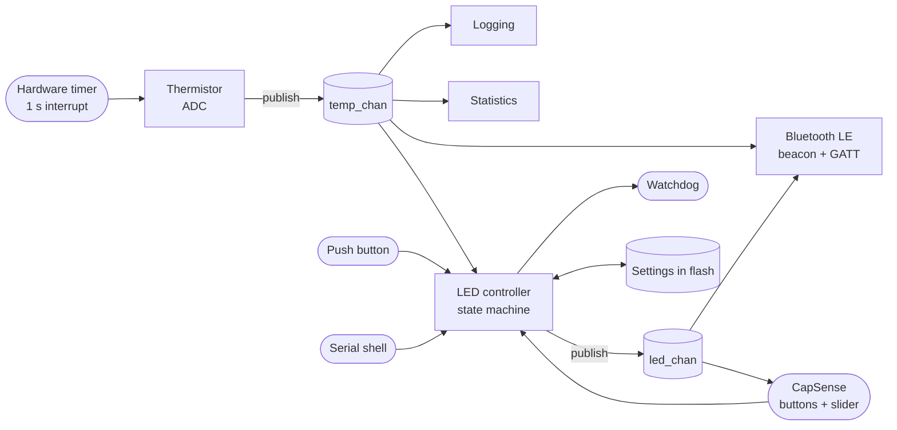
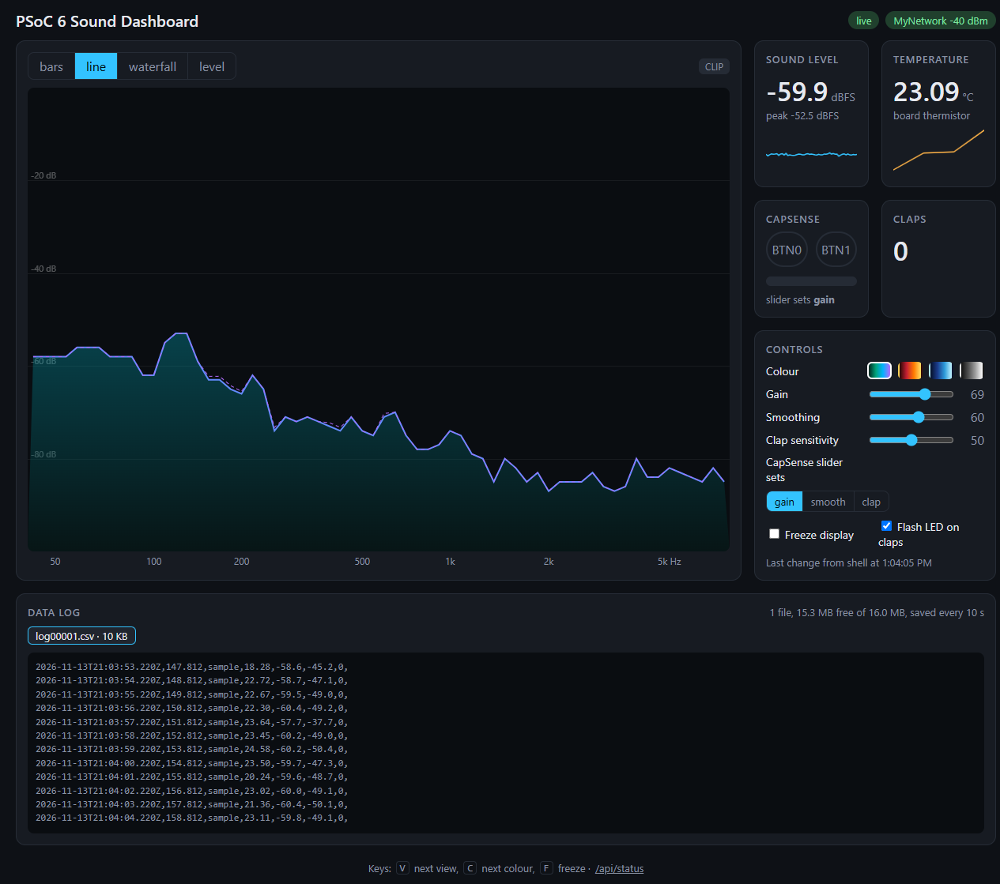
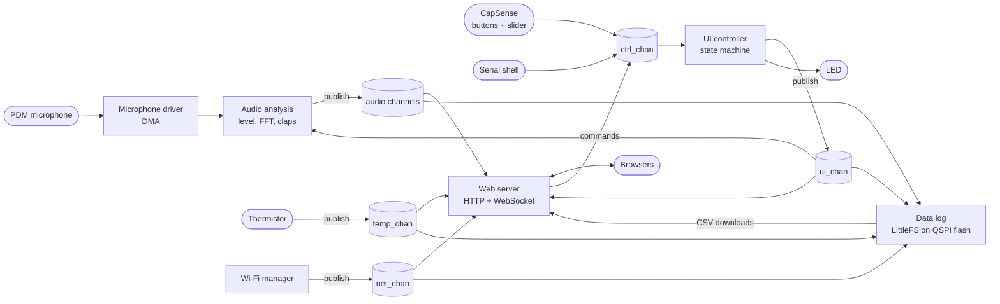

# PSoC 6 ZephyrOS Exploration

A collection of embedded projects on the **Infineon CY8CPROTO-062-4343W** prototyping kit,
built with **Zephyr RTOS**. Each project lives in its own folder under [`apps/`](apps) and
explores a different side of the board.

**The board:** PSoC 62 MCU (Cortex-M4 + Cortex-M0+, 2 MB flash, 1 MB SRAM), a CYW4343W
Wi-Fi + Bluetooth radio, CAPSENSE touch sensors, a thermistor, PDM microphones, QSPI flash
and an onboard debugger.

## Projects

| Project | Summary | Built with |
|---|---|---|
| [**Thermo-Blinky**](#thermo-blinky) | Temperature sensor node with an LED readout, a Bluetooth LE beacon and touch controls | Threads, zbus, state machines, BLE, CapSense, flash settings, watchdog |
| [**Sound Dashboard**](#sound-dashboard) | Listens through the microphone and serves a live sound dashboard over Wi-Fi, with touch and browser controls, and logs it all to flash | Custom DMA microphone driver, FFT (CMSIS-DSP), Wi-Fi, HTTP server + WebSocket, mDNS, custom QSPI flash driver, LittleFS, zbus, state machines |

---

## Thermo-Blinky

📁 [`apps/rtos_blinky`](apps/rtos_blinky) · [full details →](apps/rtos_blinky/README.md)

A blinking LED that grew, one Zephyr subsystem at a time, into a small multithreaded
sensor node.

- 🌡️ **Measures temperature** with the onboard thermistor once a second, timed by a
  hardware timer.
- 💡 **Shows it on the LED**: solid when cold, a slow blink when normal, a fast blink
  when hot.
- 📡 **Broadcasts it over Bluetooth LE**: visible in any BLE scanner, with live readings
  in nRF Connect.
- 👆 **Touch controls**: CAPSENSE buttons switch between temperature and manual modes,
  and the slider sets the blink rate.
- 💾 **Remembers** its settings across power cycles, and recovers from a stuck
  thread with a hardware watchdog.

The modules don't call each other directly. They talk through Zephyr's **zbus** message
channels, and the LED is driven by a **hierarchical state machine**:

**Highlights**
- Ports Infineon's CapSense middleware to Zephyr: clock, analog routing and interrupt
  setup that the vendor tooling normally generates.
- Runs the Bluetooth host on the PSoC 6, with the CYW4343W radio as the controller;
  uses a standard Environmental Sensing service plus a custom LED service.
- Measures the temperature in a way that cancels out supply-voltage and ADC-reference
  errors.
- 13 threads, interrupts that hand work off to threads, and a work queue, all running
  in ~288 KB of flash.

---

## Sound Dashboard

📁 [`apps/sound_dashboard`](apps/sound_dashboard) · [full details →](apps/sound_dashboard/README.md)
· 🚧 **in progress**: milestones M0–M5 of 7 done

The board listens through its microphone, analyses the sound as it arrives, and serves a
live dashboard over Wi-Fi that any browser on the same network can open.

- 🎤 **Listens** through its PDM microphone with a driver written for this chip: DMA
  streams the audio straight into memory, so the CPU only steps in once per 32 ms block.
- 📊 **Analyses the sound live**: loudness, a 64-band spectrum from an FFT, and single
  and double claps, using about 5 % of the CPU.
- 🌐 **Serves a dashboard** at `http://psoc6.local/`: the spectrum in four views at ~16
  frames per second, plus the sound level, the temperature, the touch sensors and the
  claps.
- 👆 **Two-way controls**: the CAPSENSE buttons and slider, the browser and the serial
  shell all change the same settings (view, colours, gain, clap sensitivity...), and
  every open page stays in step.
- 💡 **Flashes the LED** on every clap.
- 🗂️ **Logs everything** to its 64 MB QSPI flash as CSV: a line per second (temperature,
  sound level, claps) plus events (claps, dashboard changes, Wi-Fi, reboots), in files
  you can download from the dashboard. It survives power cuts.
- 💾 **Remembers** its settings and Wi-Fi network across power cycles, rejoins the
  network after a drop, and has a watchdog for stuck threads.

Like Thermo-Blinky, the modules talk only through **zbus** channels. Every command, from
whichever source, goes to one **state machine** that owns the dashboard's state:

**Highlights**
- Adds a microphone driver that Zephyr doesn't have for this chip (its PDM driver only
  covers the newer PSOC Edge family), behind Zephyr's standard microphone API, with a
  self-running DMA ping-pong: no dropped audio in a 10-minute test.
- Tunes the clap detector on recordings made with the board. It catches claps from 2–3 m
  away but ignores typing, and knocks or taps that reach the microphone through the board
  as a low thump.
- Embeds a dependency-free web page (8 KB gzipped) in the firmware. The live stream skips
  frames for a slow browser rather than holding up the others, and a page notices within
  seconds if the board has dropped off the network, then reconnects.
- Adds a QSPI flash driver for the PSoC 6's serial memory interface, which Zephyr doesn't
  have either. It reads the memory's own description (SFDP), so it needs no hand-written
  memory configuration. LittleFS on top came through 9 random power cuts with no damage,
  and the logger never makes audio or the dashboard wait for the flash.
- ~981 KB of flash and ~271 KB of RAM, most of it the Wi-Fi driver and firmware and the
  network stack.

**Still to do**
- **Dual core (next):** move audio capture and analysis to the PSoC 6's second core, the
  Cortex-M0+, talking to the Cortex-M4 over inter-processor messages. Zephyr has no
  Cortex-M0+ target for this chip yet, so this is an experiment.
- **Wrap-up:** final documentation and a clean-checkout build check.
- **Known limitations:** loud finger snaps sound like claps to this microphone and still
  count. The temperature reading jumps by ±2 °C from second to second, from interference
  on the thermistor's ADC. The dashboard has no TLS or login, so use it on a network you
  trust.
