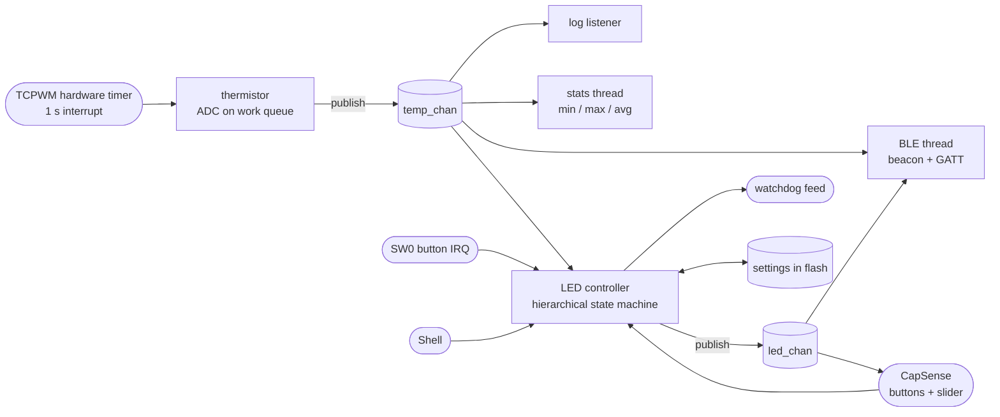

# Thermo-Blinky — a multithreaded sensor node

A small Zephyr RTOS app for the CY8CPROTO-062-4343W. It measures temperature with the
onboard thermistor, shows it on the LED, broadcasts it over Bluetooth LE, and takes input
from CAPSENSE touch buttons, a slider, a push button and a serial shell.

## Behavior

### LED modes

| Mode | LED |
|---|---|
| **Temperature** (default) | Below the *cold* limit: solid on · between the limits: 1 s blink · at or above *hot*: 100 ms blink. 0.5 °C hysteresis on both limits |
| **Manual** | Blinks at the user period (10–2000 ms), set with the slider, SW0 or the shell |

The default limits are 18 °C and 28 °C. The limits and the manual period are saved in flash.

### Controls

| Input | Action |
|---|---|
| CapSense **BTN0** | Switch to temperature mode |
| CapSense **BTN1** | Switch to manual mode |
| CapSense **slider** | Set the manual blink rate, 0.5 Hz (left) to 10 Hz (right). Ignored in temperature mode |
| **SW0** push button | Step the manual period through 500 / 250 / 100 / 1000 ms |

### Bluetooth LE

The CYW4343W radio advertises as **`PSoC6 xx.xxC`** from its public address. The
advertisement is connectable and accepts one connection at a time.

| What | Where | Format |
|---|---|---|
| Temperature in the advertisement | Device name, plus Service Data for `0x181A` (Environmental Sensing) | int16, 0.01 °C, little endian |
| Temperature | GATT `0x181A` → `0x2A6E` Temperature (read, notify) | int16, 0.01 °C |
| Blink period | Custom service `a5c40001-6d4b-4b1e-9b8d-2f7a1c3e5d00` → `a5c40002-…` (read, notify) | uint16 ms, 0 = solid |
| LED status | Same service → `a5c40003-…` (read, notify) | Text, e.g. `MANUAL 250 ms` |

In nRF Connect, connect and turn on notifications to watch the temperature and blink
period change live. If a service doesn't appear after reflashing, refresh the phone's GATT
cache. The board doesn't bond, so it can't tell the phone its services changed.

### Watchdog

The LED thread feeds a 4 s hardware watchdog. If that thread stops (try
`kernel thread suspend <led_tid>`), the chip resets, and the next boot logs
`Last reset was caused by the WATCHDOG`. The watchdog stays off while a debugger has debug
mode enabled. Press **RESET (SW1)** after flashing to arm it.

## Architecture



| File | Role |
|---|---|
| [`main.c`](src/main.c) | Startup order, the SW0 button (IRQ → semaphore → thread), and the `blink` command |
| [`thermistor.c`](src/thermistor.c) | TCPWM counter interrupt → work item → two ADC readings with the divider's polarity swapped (so the supply voltage cancels out) → Beta equation → publishes on `temp_chan` |
| [`channels.c/.h`](src/channels.h) | zbus channels `temp_chan` (with a plausibility validator) and `led_chan` |
| [`led_ctrl.c`](src/led_ctrl.c) | SMF state machine `ROOT > { TEMP > { COLD, NORMAL, HOT }, MANUAL }`. One event queue, toggles scheduled against an absolute deadline, feeds the watchdog |
| [`capsense_input.c`](src/capsense_input.c) | Zephyr port of the CapSense init (reserved clock divider, analog bus switches, CSD interrupt) and a 50 Hz scanning thread |
| [`ble_beacon.c`](src/ble_beacon.c) | Bluetooth host, advertising, and the Environmental Sensing and LED GATT services |
| [`temp_monitor.c`](src/temp_monitor.c) | The two zbus observer types: a listener (logging) and a subscriber (min/max/avg) |
| [`app_settings.c`](src/app_settings.c) | Settings subsystem on ZMS; saves are delayed 2 s so a burst of changes costs one flash write |
| [`app_watchdog.c`](src/app_watchdog.c) | Watchdog setup and feeding, plus the reset cause from the Infineon PDL |
| [`boards/cy8cproto_062_4343w.overlay`](boards/cy8cproto_062_4343w.overlay) | ADC channel, thermistor pins, the 1 MHz timer, and a 32 KB settings partition |
| [`capsense/`](capsense) | Generated CapSense configuration for this kit ([details](capsense/README.md)) |

### Threads

| Thread | Priority | Job |
|---|---|---|
| `sysworkq` | −1 | Thermistor sampling, settings saves |
| `button_tid` | 5 | SW0 debounce |
| `led_tid` | 7 | LED state machine, watchdog feed |
| `ble_tid` | 9 | Advertising updates, GATT notifications |
| `stats_tid` | 10 | Temperature statistics |
| `capsense_tid` | 12 | CapSense scanning |
| `shell_uart`, `logging` | 14 | Console |
| + 4 Bluetooth stack threads, `idle` | | |

## Shell

Open the KitProg3 serial port at 115200 8N1:

| Command | Shows / does |
|---|---|
| `temp` | Latest reading, NTC resistance, raw ADC values, timer-to-sample latency |
| `temp stats [reset]` | Min/max/average since boot |
| `temp limits [<cold> <hot>]` | Show or set the LED thresholds in whole °C (saved) |
| `led` / `led mode temp\|manual` | LED mode, state and period / switch mode |
| `blink set <ms>` | Set the manual period (10–2000 ms, saved) |
| `ble` | Address, advertising/connection state, payload, notification counts |
| `capsense` | Per-sensor raw / baseline / diff counts and slider position |
| `bus` | zbus channels, publish counts and observers |
| `settings list` / `settings read app/period` | Stored settings |
| `kernel thread list` / `kernel thread stacks` | Threads and their stack usage |

## Building and flashing

From the workspace root, after the one-time setup (`west init -m
https://github.com/Infineon/ifx-zephyr-sdk .`, `west update`, `west blobs fetch hal_infineon`,
and `west config build.cmake-args -- "-DOPENOCD=<path>/openocd/bin/openocd.exe"`):

```bash
west build -b cy8cproto_062_4343w -d apps/rtos_blinky/build/proto062 apps/rtos_blinky
west flash -d apps/rtos_blinky/build/proto062
```

- The first build clones the Infineon CapSense middleware (v3.0.1, Infineon EULA) into
  `modules/lib/capsense`.
- Keep the build folder name short: with Bluetooth enabled, longer paths exceed the Windows
  260-character limit inside the crypto library.
- For debugging, use the **"rtos_blinky: Debug (CM4)"** configuration in `.vscode/launch.json`.
  It attaches to the Cortex-M4 and shows every Zephyr thread.

**Footprint:** ~288 KB flash, ~61 KB RAM.
