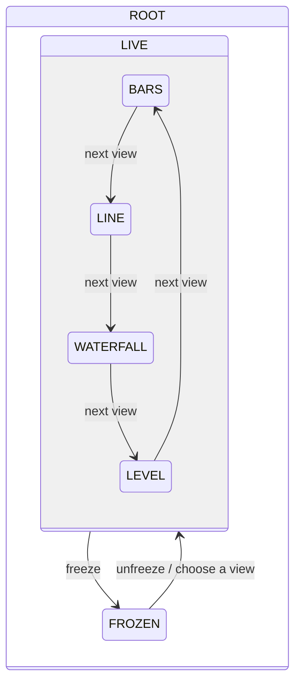

# Sound Dashboard: a sound-reactive Wi-Fi dashboard

A Zephyr RTOS app for the CY8CPROTO-062-4343W. The board listens through its PDM
microphone, computes the sound level and an FFT spectrum, detects claps, and serves a live
dashboard over Wi-Fi. The dashboard also shows the temperature and the CAPSENSE buttons and
slider, which (like the browser) control what the dashboard shows. Data is logged to the
QSPI flash.

It builds on [Thermo-Blinky](../rtos_blinky): the thermistor and CapSense code is copied
from there and adapted, and the modules talk through zbus channels in the same way.

> **Status: in progress.** Built one milestone at a time:
>
> | Milestone | State |
> |---|---|
> | M0 Scaffolding: sensors, zbus channels, UI state machine, watchdog supervisor | ✅ |
> | M1 PDM microphone driver (custom, DMA) | ⏳ |
> | M2 Audio DSP: level, FFT, clap detection | ⏳ |
> | M3 Wi-Fi, web dashboard, mDNS | ⏳ |
> | M4 CapSense and browser controls | ⏳ |
> | M5 QSPI flash logging (custom SMIF driver, LittleFS) | ⏳ |
> | M6 Dual core: audio on the Cortex-M0+ | ⏳ |

## Architecture

Every module publishes or observes [zbus](https://docs.zephyrproject.org/latest/services/zbus/index.html)
channels ([`channels.h`](src/channels.h)); none calls another directly.

| Channel | Published by | Observed by |
|---|---|---|
| `temp_chan` | thermistor (1 Hz) | web, datalog, shell |
| `audio_level_chan`, `audio_spectrum_chan` | audio DSP | web, datalog |
| `audio_event_chan` (claps) | audio DSP | UI controller (LED flash), web, datalog |
| `input_chan` (live touch state) | CapSense | web |
| `ctrl_chan` (commands) | CapSense, web, shell | UI controller |
| `ui_chan` (dashboard state) | UI controller | web, audio DSP, datalog |
| `net_chan` | Wi-Fi manager | web, datalog, shell |

Commands from every source go through `ctrl_chan` to one owner, the UI controller, which
validates them, saves the state and publishes it on `ui_chan`. Everything that renders the
dashboard follows `ui_chan`, so the browser, the CapSense buttons and the shell always agree.

The UI controller is a hierarchical state machine ([SMF](https://docs.zephyrproject.org/latest/services/smf/index.html)):



`ROOT` handles what applies in every state: colour scheme, display gain, smoothing, clap
sensitivity, which parameter the slider sets, and flashing the LED on a clap.

| File | Role |
|---|---|
| [`main.c`](src/main.c) | Startup order |
| [`channels.c/.h`](src/channels.h) | All zbus channels and message types |
| [`ui_ctrl.c`](src/ui_ctrl.c) | UI state machine, owns `ui_chan`, flashes the LED on claps |
| [`capsense_input.c`](src/capsense_input.c) | CapSense scanning (port from rtos_blinky): publishes `input_chan` and `ctrl_chan` |
| [`thermistor.c`](src/thermistor.c) | Ratiometric NTC measurement once a second (from rtos_blinky), publishes `temp_chan` |
| [`app_settings.c`](src/app_settings.c) | Persisted UI state (Settings on ZMS, `dash/` keys), saved 2 s after the last change on a low-priority work queue |
| [`app_watchdog.c`](src/app_watchdog.c) | Hardware watchdog fed by a supervisor only while every key thread checks in; names the stalled thread after a watchdog reset |
| [`bus_monitor.c`](src/bus_monitor.c) | `bus` shell diagnostics |
| [`ext/`](ext) | Repo-local Zephyr module for the PSoC 6 drivers and bindings this Zephyr tree lacks |

### CapSense controls

| Input | Action |
|---|---|
| **BTN0** | Next view (bars → line → waterfall → level) |
| **BTN1** | Next colour scheme; hold for 0.8 s to freeze or unfreeze the display |
| **Slider** | Sets the selected parameter (`ui slider ...`), 0 at the left to 100 at the right |

The SW0 push button isn't used: on this board its pin (P0.4) is also the Wi-Fi host-wake
interrupt, which the Wi-Fi driver owns.

## Shell

Open the KitProg3 serial port at 115200 8N1:

| Command | Shows / does |
|---|---|
| `ui` | Dashboard state: view, colour, parameters, what the slider sets |
| `ui view next\|bars\|line\|waterfall\|level` | Change the view |
| `ui colour next\|<n>`, `ui freeze [on\|off]` | Colour scheme, freeze |
| `ui param gain\|smooth\|clap <0..100>`, `ui slider gain\|smooth\|clap` | Parameters, slider target |
| `ui ledclap on\|off` | Flash the user LED on claps |
| `temp` | Latest thermistor reading |
| `capsense` | Per-sensor raw / baseline / diff counts and slider position |
| `bus`, `bus watch on\|off` | zbus channels and observers; log every command and state change |
| `watchdog` | Supervisor status per thread |
| `kernel thread list` / `kernel thread stacks` | Threads, CPU usage and stack usage |

## Building and flashing

From the workspace root, after the one-time setup described in the
[top-level README](../../README.md) (`west init`, `west update`, `west blobs fetch hal_infineon`):

```bash
west build -b cy8cproto_062_4343w -d apps/sound_dashboard/build/proto062 apps/sound_dashboard
west flash -d apps/sound_dashboard/build/proto062
```

- The west manifest doesn't include everything this app needs, so the first build clones
  these into the workspace's `modules/` folder (see
  [`cmake/fetch_modules.cmake`](cmake/fetch_modules.cmake)): the Infineon CapSense
  middleware (v3.0.1, Infineon EULA), and Zephyr's CMSIS-DSP and LittleFS modules at the
  revisions this Zephyr tree pins.
- With more than one debug probe attached, pick the kit's KitProg3:
  `west flash ... --serial <KitProg3 serial number>`.
- The watchdog stays off while a debugger has enabled debug mode (e.g. right after
  flashing). Press **RESET (SW1)** to arm it.
- For debugging, use **"sound_dashboard: Debug (CM4)"** in `.vscode/launch.json`.

**Footprint (M0):** ~151 KB flash, ~52 KB RAM.
