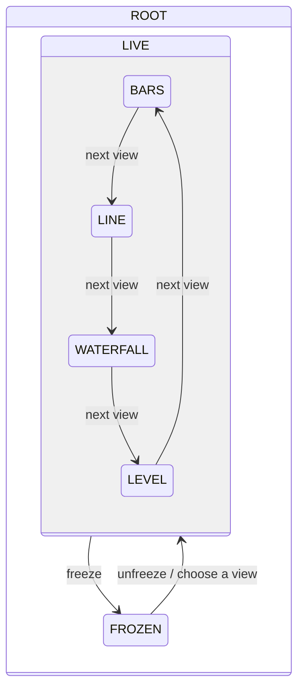

# Sound Dashboard: a sound-reactive Wi-Fi dashboard

A Zephyr RTOS app for the CY8CPROTO-062-4343W. The board listens through its PDM
microphone, computes the sound level and an FFT spectrum, detects claps, and serves a live
dashboard over Wi-Fi. The dashboard also shows the temperature and the CAPSENSE buttons and
slider, which (like the browser) control what the dashboard shows. Data is logged to the
QSPI flash.

It builds on [Thermo-Blinky](../rtos_blinky): the thermistor and CapSense code is copied
from there and adapted, and the modules talk through zbus channels in the same way.

> **Status: in progress.** Built one milestone at a time:
>
> | Milestone | State |
> |---|---|
> | M0 Scaffolding: sensors, zbus channels, UI state machine, watchdog supervisor | ✅ |
> | M1 PDM microphone driver (custom, DMA) | ✅ |
> | M2 Audio DSP: level, FFT, clap detection | ✅ |
> | M3 Wi-Fi, web dashboard, mDNS | ⏳ |
> | M4 CapSense and browser controls | ⏳ |
> | M5 QSPI flash logging (custom SMIF driver, LittleFS) | ⏳ |
> | M6 Dual core: audio on the Cortex-M0+ | ⏳ |

## Architecture

Every module publishes or observes [zbus](https://docs.zephyrproject.org/latest/services/zbus/index.html)
channels ([`channels.h`](src/channels.h)); none calls another directly.

| Channel | Published by | Observed by |
|---|---|---|
| `temp_chan` | thermistor (1 Hz) | web, datalog, shell |
| `audio_level_chan`, `audio_spectrum_chan` | audio DSP | web, datalog |
| `audio_event_chan` (claps) | audio DSP | UI controller (LED flash), web, datalog |
| `input_chan` (live touch state) | CapSense | web |
| `ctrl_chan` (commands) | CapSense, web, shell | UI controller |
| `ui_chan` (dashboard state) | UI controller | web, audio DSP, datalog |
| `net_chan` | Wi-Fi manager | web, datalog, shell |

Commands from every source go through `ctrl_chan` to one owner, the UI controller, which
validates them, saves the state and publishes it on `ui_chan`. Everything that renders the
dashboard follows `ui_chan`, so the browser, the CapSense buttons and the shell always agree.

The UI controller is a hierarchical state machine ([SMF](https://docs.zephyrproject.org/latest/services/smf/index.html)):



`ROOT` handles what applies in every state: colour scheme, display gain, smoothing, clap
sensitivity, which parameter the slider sets, and flashing the LED on a clap.

| File | Role |
|---|---|
| [`main.c`](src/main.c) | Startup order |
| [`channels.c/.h`](src/channels.h) | All zbus channels and message types |
| [`audio_capture.c`](src/audio_capture.c) | Microphone stream (DMIC API) and the analysis thread: publishes level, spectrum and clap events |
| [`audio_dsp.c/.h`](src/audio_dsp.h) | The analysis itself, plain C with no Zephyr dependencies: level, FFT bands, clap detector ([tests](tests/dsp)) |
| [`ui_ctrl.c`](src/ui_ctrl.c) | UI state machine, owns `ui_chan`, flashes the LED on claps |
| [`capsense_input.c`](src/capsense_input.c) | CapSense scanning (port from rtos_blinky): publishes `input_chan` and `ctrl_chan` |
| [`thermistor.c`](src/thermistor.c) | Ratiometric NTC measurement once a second (from rtos_blinky), publishes `temp_chan` |
| [`app_settings.c`](src/app_settings.c) | Persisted UI state (Settings on ZMS, `dash/` keys), saved 2 s after the last change on a low-priority work queue |
| [`app_watchdog.c`](src/app_watchdog.c) | Hardware watchdog fed by a supervisor only while every key thread checks in; names the stalled thread after a watchdog reset |
| [`bus_monitor.c`](src/bus_monitor.c) | `bus` shell diagnostics |
| [`ext/`](ext) | Repo-local Zephyr module: the PSoC 6 PDM microphone driver and its devicetree binding |
| [`boards/cy8cproto_062_4343w.overlay`](boards/cy8cproto_062_4343w.overlay) | Audio clock (PLL0 → CLK_HF1), PDM pins and node, thermistor, settings partition |

### Microphone driver

Zephyr's Infineon PDM driver only supports the newer PDM-PCM block of PSOC Edge, and the
PSoC 6 devicetree has no PDM node at all. So [`ext/drivers/audio/dmic_psoc6_pdm.c`](ext/drivers/audio/dmic_psoc6_pdm.c)
implements Zephyr's standard DMIC API (`dmic_configure`, `dmic_trigger`, `dmic_read`) on the
PSoC 6 audio subsystem, using the PDL's v1 PDM-PCM driver for the registers:

- **Clock:** PLL0 at 24.576 MHz (a multiple of every audio rate) drives CLK_HF1, which the
  converter divides to the PDM clock: 16 kHz × 64 = 1.024 MHz on P10.4. The dividers are
  picked at run time from the requested rate.
- **DMA:** the PDM's DMA request is wired one-to-one to DataWire 1 channel 26. The driver
  programs that channel itself with an endless chain of two descriptors. Each one fills one
  application buffer (from a memory slab) in bursts of up to 128 samples per request, so the
  DMA writes straight into the buffers `dmic_read()` returns and the CPU runs once per
  512-sample block. The interrupt asks the hardware which descriptor is active, so it
  recovers correctly even if a flash write stalls the CPU for longer than a block.
  Zephyr's DataWire driver can't run such a chain, so the `dma1` node stays disabled.
- Without `dmas` in the devicetree (or with `CONFIG_DMIC_PSOC6_PDM_DMA=n`) the driver
  empties the FIFO from its interrupt instead.
- Mono left, mono right or stereo; 16- or 32-bit samples; gain in 1.5 dB steps.

Measured on the kit: 0 dropped blocks and 0 FIFO overflows over a 10-minute run with
settings being saved to flash every 20 s. The sample rate measures 16.03–16.06 kHz against
the nominal 15.997 kHz, because the CPU's timebase (FLL) and the audio clock (PLL) lock to
the internal oscillator independently. Both microphones (left and right on the PDM line)
work.

### Audio analysis

Every 512-sample block (32 ms at 16 kHz) goes through [`audio_dsp.c`](src/audio_dsp.c):

- **Level:** RMS and peak in dBFS (a full-scale sine reads 0 dBFS peak, −3 dBFS RMS), plus
  clipping.
- **Spectrum:** a 1024-point Hann-windowed real FFT (CMSIS-DSP) over the latest 1024
  samples, sliding by one block (50 % overlap). Its power is summed into 64 log-spaced
  bands from 40 Hz to 8 kHz, scaled so a full-scale sine reads 0 dB in its band. Every two
  blocks (~16 Hz) the averaged bands are smoothed, offset by the display gain, and published
  as 0–100 dB above −100 dBFS.
- **Claps:** the energy of the signal's first difference (a gentle high-pass that ignores
  room rumble) in 8 ms steps, against a background level that follows quiet sound quickly
  and loud sound slowly. A candidate needs a sharp rise (>9 dB in 8 ms) well above the
  background (10–30 dB, from the clap sensitivity), and only counts if it dies away by
  12 dB within 56 ms: speech and music sustain, claps don't. A second clap 100–700 ms after
  the first is a double clap. The first 100 ms after the microphone starts are skipped:
  its start-up transient looks like a clap.

The analysis takes ~1.6 ms per 32 ms block on the Cortex-M4 (5 % CPU): level 0.12 ms,
FFT and bands 1.1 ms, claps 0.2 ms, publishing 0.14 ms (`audio` shows this live). The FFT
dominates because its code and tables (~9 KB) don't fit the 8 KB flash cache; moving them
to SRAM would speed it up if needed.

### CapSense controls

| Input | Action |
|---|---|
| **BTN0** | Next view (bars → line → waterfall → level) |
| **BTN1** | Next colour scheme; hold for 0.8 s to freeze or unfreeze the display |
| **Slider** | Sets the selected parameter (`ui slider ...`), 0 at the left to 100 at the right |

The SW0 push button isn't used: on this board its pin (P0.4) is also the Wi-Fi host-wake
interrupt, which the Wi-Fi driver owns.

## Shell

Open the KitProg3 serial port at 115200 8N1:

| Command | Shows / does |
|---|---|
| `audio` | Sound level, ASCII spectrum, clap count, analysis time per stage |
| `mic`, `mic level [s]` | Microphone status; live level meter |
| `mic start [left\|right]`, `mic stop` | Start/stop capturing, pick the microphone |
| `mic stats` | Driver counters (blocks, drops, FIFO overflows, interrupts) and measured sample rate |
| `mic dump [n]` | The next n raw samples as text, for offline analysis |
| `ui` | Dashboard state: view, colour, parameters, what the slider sets |
| `ui view next\|bars\|line\|waterfall\|level` | Change the view |
| `ui colour next\|<n>`, `ui freeze [on\|off]` | Colour scheme, freeze |
| `ui param gain\|smooth\|clap <0..100>`, `ui slider gain\|smooth\|clap` | Parameters, slider target |
| `ui ledclap on\|off` | Flash the user LED on claps |
| `temp` | Latest thermistor reading |
| `capsense` | Per-sensor raw / baseline / diff counts and slider position |
| `bus`, `bus watch on\|off` | zbus channels and observers; log every command and state change |
| `watchdog` | Supervisor status per thread |
| `kernel thread list` / `kernel thread stacks` | Threads, CPU usage and stack usage |

## Building and flashing

From the workspace root, after the one-time setup described in the
[top-level README](../../README.md) (`west init`, `west update`, `west blobs fetch hal_infineon`):

```bash
west build -b cy8cproto_062_4343w -d apps/sound_dashboard/build/proto062 apps/sound_dashboard
west flash -d apps/sound_dashboard/build/proto062
```

- The west manifest doesn't include everything this app needs, so the first build clones
  these into the workspace's `modules/` folder (see
  [`cmake/fetch_modules.cmake`](cmake/fetch_modules.cmake)): the Infineon CapSense
  middleware (v3.0.1, Infineon EULA), and Zephyr's CMSIS-DSP and LittleFS modules at the
  revisions this Zephyr tree pins.
- With more than one debug probe attached, pick the kit's KitProg3:
  `west flash ... --serial <KitProg3 serial number>`.
- The watchdog stays off while a debugger has enabled debug mode (e.g. right after
  flashing). Press **RESET (SW1)** to arm it.
- For debugging, use **"sound_dashboard: Debug (CM4)"** in `.vscode/launch.json`.

### Tests

The analysis has unit tests on synthetic signals ([`tests/dsp`](tests/dsp)): level
calibration, band layout, tones landing in the right band at the right level, smoothing and
gain, and the clap detector (single, double, far apart, sustained sound, quiet room,
sensitivity). They run on the kit:

```bash
west build -b cy8cproto_062_4343w -d apps/sound_dashboard/tests/dsp/build/proto062 apps/sound_dashboard/tests/dsp
west flash -d apps/sound_dashboard/tests/dsp/build/proto062
```

and print the results on the serial console. (`testcase.yaml` also lists QEMU targets, but
the Zephyr SDK's Windows QEMU needs a MinGW runtime DLL, `libgcc_s_seh-1.dll`, that it
doesn't ship.)

**Footprint (M2):** ~182 KB flash, ~87 KB RAM.
